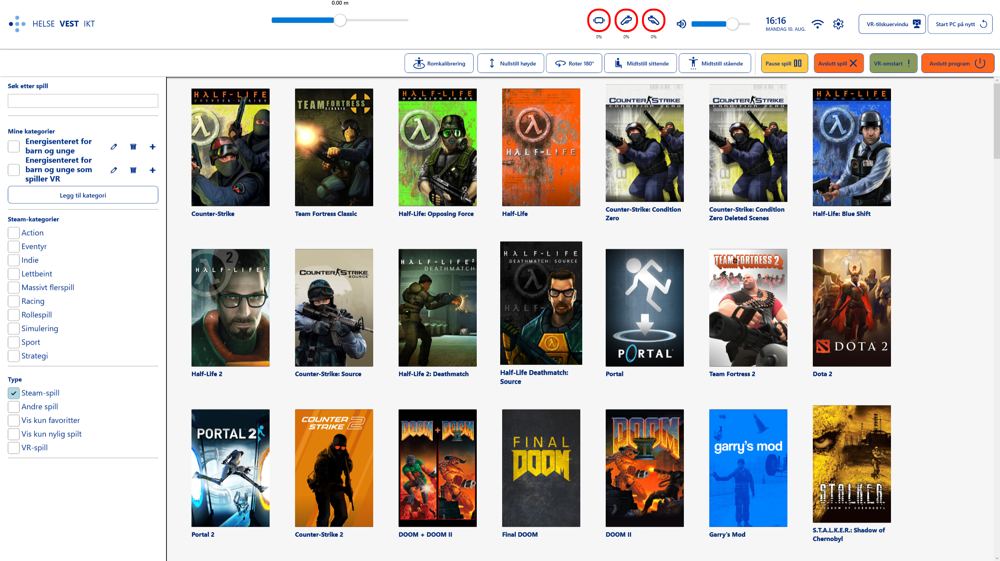

# Hi, I'm Jonas Rønningen 👋

Software developer from Vinstra, Norway. I built and delivered a production desktop application for Helse Vest IKT, carrying it alone from bachelor project to handover. Now I build web backends and real-time data pipelines on my own time, and I'm looking for a full-time developer role.

- BSc in Computer Engineering, Western Norway University of Applied Sciences (HVL). One course left, exam January 2027.
- Exchange semester at Griffith University, Australia (2024), taught in English.
- [LinkedIn](https://www.linkedin.com/in/jonas-r-a5428a132/) · jonas-the@hotmail.com

## Production work: VR Dashboard for Helse Vest IKT

**Rønningen Interactive (own company) · Jan 2025 – Jul 2026**

A desktop application that lets healthcare staff without a technical background run the VR equipment at Energisenteret for barn og unge, Haukeland University Hospital: device status, Wi-Fi, audio, applications and profiles.

- Started as my bachelor project in a team of four (Jan–Jun 2025). I then continued it alone as a paid assignment until handover in July 2026.
- Gathered requirements with healthcare staff and turned them into features.
- C#/.NET, WPF and MVVM, integrated with SteamVR, OpenVR and the connected VR hardware.
- Refactored toward a clear split between views, ViewModels and services.
- Owned technical decisions, testing, documentation and delivery in a regulated healthcare environment.
- **Outcome:** in production since late summer 2026. Helse Vest IKT now develops it further themselves, based on the code and documentation I handed over.

The bachelor thesis (in Norwegian) is published in [Nasjonalt vitenarkiv](https://nva.sikt.no/registration/01990ef7e798-5689216a-c6c0-482f-bbf8-f312c5d483e3).

## Personal projects

### [adsb-pipeline](https://github.com/h669791/adsb-pipeline): live aircraft map from ADS-B data

`TypeScript` `Node.js` `Fastify` `WebSocket` `React` `MapLibre GL JS`

Takes the aircraft feed from a radio receiver and turns it into a live operator map. Raw data is validated and normalized at the boundary, so unknown values stay `null` instead of becoming 0. Stale positions fade and get a growing uncertainty circle, so old data never looks fresh.

**Status:** works end to end with test data. Next step is live reception with an RTL-SDR dongle on a Raspberry Pi.

### [DeviceHub](https://github.com/h669791/devicehub): REST API for managing simulated VR headsets

`C#` `ASP.NET Core` `Entity Framework Core` `PostgreSQL` `Docker`

Written from scratch on my own time, using simulated data only.

- REST API with CRUD, DTOs that separate the API contract from the database model, input validation and 404/409 handling.
- PostgreSQL in Docker, with the schema managed through EF Core migrations.

**Next:** sessions with business rules, live status with SignalR and a React frontend, xUnit tests and CI with GitHub Actions.

## Tech

| Where I've used it | Technologies |
| --- | --- |
| Production | C#, .NET, WPF, MVVM, SteamVR/OpenVR, hardware integration |
| Personal projects | ASP.NET Core, EF Core, PostgreSQL, Docker, TypeScript, React, Node.js |
| Coursework | Java, Spring MVC, JPA, Angular, Python, SQL, C++ |

Tools: Git, GitHub, Visual Studio, VS Code.
